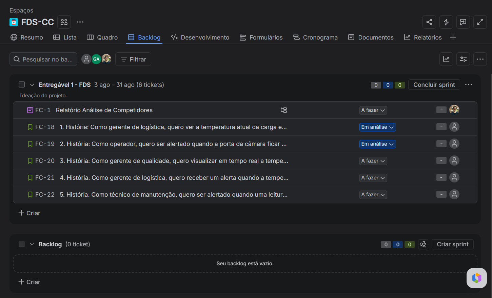
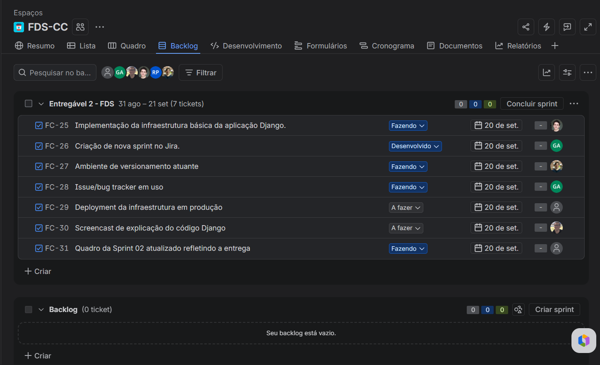
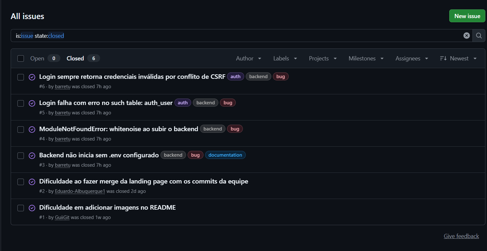
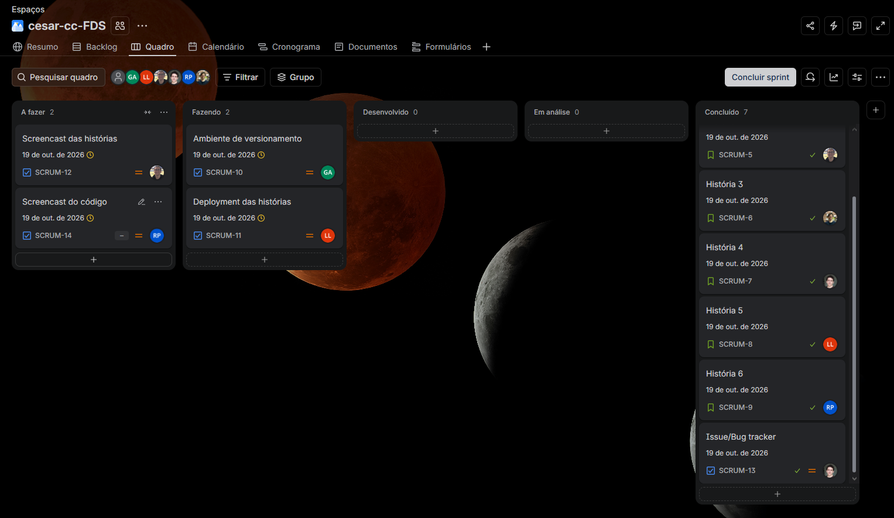
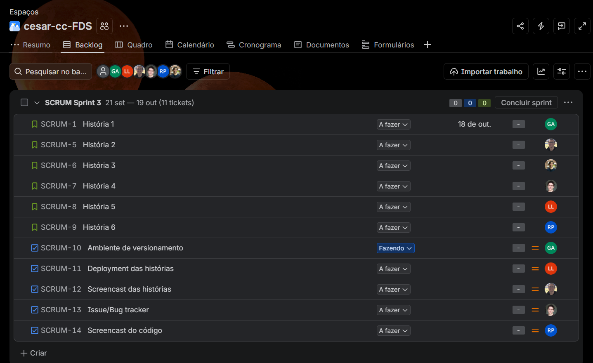
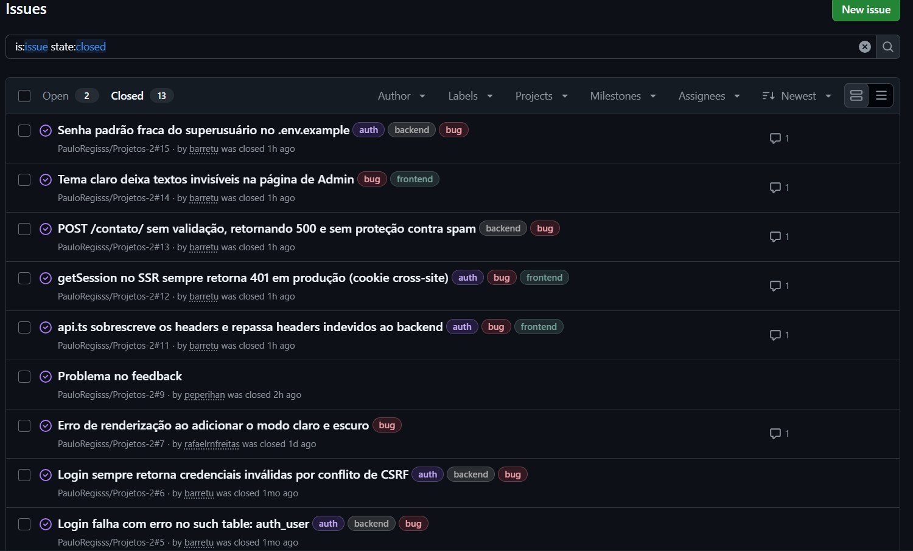

# Projeto Nexus

[](https://github.com/PauloRegisss/Projetos-2/actions/workflows/ci.yml)

> Projeto desenvolvido em parceria com a **BzuTech** (empresa de IoT), como parte da disciplina de Projetos do 2º período — CESAR School.

## 📌 Tema

Educar empresas sobre a importância de coletar dados operacionais por meio de IoT para melhorar a gestão, performance e a tomada de decisão.

## 🌐 Acesse o Projeto

🔗 **Link do deploy:** [nexus-frontend-5ip8.onrender.com](https://nexus-frontend-5ip8.onrender.com/)

## 📝 Descrição do Projeto

Muitas empresas ainda tomam decisões operacionais com base em observação manual e experiência, sem dados concretos sobre o que realmente acontece no dia a dia da operação — seja no chão de fábrica, na lavoura, na cadeia de frios ou na frota de transporte. Esse projeto, desenvolvido em parceria com a BzuTech, tem como objetivo mostrar de forma clara e visual o diferencial que a aplicação de IoT (Internet das Coisas) traz para diferentes setores de negócio.

Uma plataforma interativa que mensura o impacto do IoT no seu negócio. Por meio de um chatbot conversacional estilo autoatendimento, a empresa informa seu cenário atual; a partir das respostas, o sistema calcula as métricas de desempenho e eficiência com e sem a aplicação de IoT, e uma Inteligência Artificial gera uma análise personalizada do resultado. Tudo isso é apresentado em um Showroom Interativo, com link próprio para cada simulação.

O projeto conta ainda com um canal de contato integrado ao backend, permitindo que visitantes enviem mensagens que ficam disponíveis para a equipe através de um painel administrativo próprio.

## 👥 Integrantes

### Ciência da Computação

| Nome | Email Institucional |
|------|----------------------|
| Guilherme Fernandes de Lima Araújo | gfla@cesar.school |
| Luiz Eduardo Albuquerque Alves de Lima | leaal@cesar.school |
| Paulo César Regis de Lima | pcrl@cesar.school |
| Pedro Antonio Beltrão Rihan | pabr@cesar.school |
| Rafael Ramos Novaes de Freitas | rrnf@cesar.school |
| Ricardo Marinho do Prado | rmp3@cesar.school |
| Thony Guilherme de Aquino Barreto | tgab@cesar.school |

### Design

| Nome | Email Institucional |
|------|----------------------|
| Helena Gabrielli Bezerra Santos | hgbs@cesar.school |
| Júlia Teixeira Catão Ribeiro | jtcr@cesar.school |
| Sofia Marinho de Hollanda Cavalcanti | smhc@cesar.school |
| Thamires Gestosa Vieira | tgv@cesar.school |

## 🏢 Empresa Parceira

**BzuTech** — IoT para eficiência máxima.
Site da BzuTech: [www.bzutech.com.br](https://www.bzutech.com.br)
## 📋 Gestão do Projeto

- **Jira:** https://cesar-team-fds-cc.atlassian.net/jira/software/projects/SCRUM/boards/1?filter=&groupBy=none&atlOrigin=eyJpIjoiYTQ0MDkxMzk1MTkzNDQ3NmJhY2RkNDM1ODJiYTcxYTEiLCJwIjoiaiJ9

## Entregável 1 FDS 
- **Print do Backlog:** 


- **Análise de Competidores:**
[Análise de Competidores.md](./An%C3%A1lise%20de%20Competidores.md)

## Entregável 2 FDS 

- **Deployment da infraestrutura em produção:**
https://www.youtube.com/watch?v=cQkOwgvnDnk

- **Screencast de explicação do código Django:**
https://www.youtube.com/watch?v=sYD3GoiuwKU

- **Print do Backlog:**


- **Issue/bug tracker:**


## Entregável 3 FDS
- **Print da Sprint:**


- **Print do Backlog:**

  
- **Issue/bug tracker:**


- **Histórias de usuário:** as histórias, com os cenários de validação em BDD (Dado / Quando / Então), estão em **[historias.md](./historias.md)**.

### Histórias implementadas

> **📌 História 1 – Alternar tema claro/escuro**<br>
> **Como** usuário da plataforma, **quero** alternar entre o modo claro e o modo escuro, **para** adaptar a visualização à minha preferência e conforto visual.<br>
> **Critérios de aceitação:** botão de tema no cabeçalho do site e do painel administrativo; troca imediata das cores; preferência lembrada ao voltar ao site; na primeira visita, segue o tema do sistema.

> **📌 História 2 – Abrir o chatbot**<br>
> **Como** tomador de decisão do negócio, **quero** abrir a tela do chatbot conversacional, **para** iniciar a avaliação do impacto do IoT na minha empresa.<br>
> **Critérios de aceitação:** botão flutuante abre o chat; o chat fecha pelo botão ou pela tecla Esc.<br>
> **Issues:** #16, #21

> **📌 História 3 – Receber as perguntas**<br>
> **Como** usuário, **quero** receber perguntas automatizadas sobre a operação do meu negócio, **para** que a IA compreenda o meu cenário atual.<br>
> **Critérios de aceitação:** perguntas carregadas do backend (`GET /chat/perguntas/`); uma pergunta por vez, com barra de progresso; campo adequado a cada tipo (texto, número ou opções).<br>
> **Issues:** #16, #21

As histórias 4, 5 e 6 foram planejadas nesta entrega e concluídas na [Entrega 4](#entregável-4-fds).

### Screencasts

- **Screencast de explicação do código Django:** https://youtu.be/BoUk_r2xlSQ
- **Screencast do deploy das histórias de usuário:** _(link do YouTube)_

## Entregável 4 FDS

- **Print da Sprint 4:** _(adicionar o print do quadro da Sprint 4 em `Prints/` e trocar esta linha pela imagem)_

- **Histórias de usuário:** cenários BDD em **[historias.md](./historias.md)**.

- **Como contribuir:** **[CONTRIBUTING.md](./CONTRIBUTING.md)**, com o passo a passo para rodar, testar e enviar mudanças.

### Histórias implementadas

As histórias 4, 5 e 6 foram planejadas na Entrega 3 e concluídas nesta sprint, com o novo visual do chat e do Showroom, a correção do botão "Refazer simulação", o contraste no tema claro e as animações. A história 7 é nova.

> **📌 História 4 – Responder às perguntas**<br>
> **Como** usuário da plataforma, **quero** responder às perguntas do chatbot, **para** que a IA receba os dados reais da minha empresa.<br>
> **Critérios de aceitação:** resposta inválida não avança e mostra o motivo; é possível voltar e recomeçar (com confirmação); cada resposta deixa o sinal ao fundo mais limpo; o backend valida de novo (`POST /chat/simular/`) e recusa dados inválidos com erro por campo.<br>
> **Teste E2E:** [`test_historia_4_responder.py`](./e2e/test_historia_4_responder.py) · **Issues:** #17, #21, #22

> **📌 História 5 – Gerar o Showroom**<br>
> **Como** usuário, **quero** que os dados informados sejam processados e gerem um Showroom Interativo, **para** que o impacto do IoT no meu negócio seja calculado automaticamente.<br>
> **Critérios de aceitação:** métricas com e sem IoT calculadas no backend; quem já usa sensores tem ganho menor que quem monitora manualmente; análise gerada por IA, com texto padrão se a IA estiver indisponível; simulação salva com id próprio; limite de 5 simulações por minuto.<br>
> **Teste E2E:** [`test_historia_5_gerar_showroom.py`](./e2e/test_historia_5_gerar_showroom.py) · **Issues:** #18, #19, #20, #24

> **📌 História 6 – Visualizar o Showroom**<br>
> **Como** tomador de decisão do negócio, **quero** visualizar o Showroom gerado, **para** comparar as métricas da minha empresa com e sem IoT.<br>
> **Critérios de aceitação:** economia mensal e anual; comparativo de energia, manutenção, paradas e desperdício; análise e aviso de estimativa; link próprio (`/showroom/<id>`) que pode ser recarregado e compartilhado; simulação inexistente mostra aviso e o botão "Refazer simulação"; chamada para a página de contato.<br>
> **Teste E2E:** [`test_historia_6_visualizar_showroom.py`](./e2e/test_historia_6_visualizar_showroom.py) · **Issues:** #23

> **📌 História 7 – Tirar dúvidas sobre IoT no chat**<br>
> **Como** visitante do site, **quero** fazer perguntas sobre IoT para a assistente NEXUS, **para** entender como a tecnologia pode ajudar a minha operação.<br>
> **Critérios de aceitação:** o chat responde às perguntas sobre IoT usando a IA quando há chave configurada e uma base local de respostas quando não há ou quando a IA falha; pedir "um exemplo" continua o assunto anterior; assuntos fora do tema são recusados com uma sugestão de pergunta; limite de 20 mensagens por minuto.<br>
> **Teste E2E:** [`test_historia_7_duvidas_iot.py`](./e2e/test_historia_7_duvidas_iot.py) · **Issues:** #25

### Testes de sistema (E2E)

Os cenários BDD de cada história viraram testes automatizados com **Selenium** e **pytest**, na pasta [`e2e/`](./e2e). Eles abrem o Chrome, navegam pelo site como um usuário e conferem o resultado, do navegador até o banco de dados.

| História | Cenários testados |
|----------|-------------------|
| 1 a 3 (regressão) | tema lembrado após recarregar; chat abre e fecha com Esc; simulação começa pela primeira pergunta |
| 4 | resposta válida avança; número inteiro, campo vazio e limite máximo são recusados; voltar e recomeçar |
| 5 | gera e abre o Showroom; ganho menor com sensores; análise padrão sem IA |
| 6 | economia, comparativo e análise; link próprio após recarregar; simulação inexistente; ida ao contato |
| 7 | pergunta sobre IoT; pedido de exemplo continua o assunto; assunto fora do tema é recusado |

```bash
bun run e2e        # roda os 13 testes, sem abrir janela (é o que o CI usa)
bun run e2e:demo   # abre o Chrome devagar, com uma legenda para cada cenário
```

### CI/CD

O pipeline [`.github/workflows/ci.yml`](./.github/workflows/ci.yml) roda em todo push e pull request:

```text
push / PR ──► Backend: testes Django + migrations ─┐
          └─► Frontend: tipos + build ─────────────┴─► Testes E2E (Selenium) ─► Deploy no Render
```

Na `main`, o Render só publica o novo commit depois que todos os checks passam (`autoDeployTrigger: checksPass` no [`render.yaml`](./render.yaml)). Se um teste falhar, a versão no ar continua a anterior.

### Screencasts

- **Deploy das novas histórias:** _(link do YouTube)_
- **Execução dos testes de sistema (Selenium):** _(link do YouTube)_
- **CI/CD, do build aos testes e ao deploy:** _(link do YouTube)_
- **Explicação do código Django das novas histórias:** _(link do YouTube)_

## 🛠️ Tecnologias

**Backend**


-D97757?style=for-the-badge&logo=anthropic&logoColor=white)

**Frontend**


**Infraestrutura**


## 🚀 Como executar o projeto

### Pré-requisitos

Antes de iniciar, certifique-se de ter instalado:

* [Bun](https://bun.sh/)
* [Python 3](https://www.python.org/)
* Git

Verifique as versões instaladas:

```bash
bun --version
python --version
git --version
```

### 1. Clone o repositório

```bash
git clone https://github.com/PauloRegisss/Projetos-2.git
```

Entre na pasta do projeto:

```bash
cd Projetos-2
```

### 2. Instale as dependências

```bash
bun run setup
```

### 3. Configure as variáveis de ambiente

Crie o arquivo `.env` a partir do arquivo de exemplo:

```bash
cp .env.example .env
```

Depois, configure as variáveis de ambiente necessárias no arquivo `.env`. Para rodar localmente, use:

```env
WAKU_PUBLIC_BACKEND_URL="http://localhost:8000"
DEBUG=True
ALLOWED_HOSTS="localhost,127.0.0.1"
```

A variável `ANTHROPIC_API_KEY` é opcional: sem ela, o Showroom usa uma análise padrão no lugar da gerada pela IA, e o chat flutuante responde com uma base local de perguntas sobre IoT.

### 4. Crie o banco de dados

Aplique as migrations (cria as tabelas de contatos e de simulações):

```bash
apps/backend/.venv/bin/python apps/backend/manage.py migrate
```

Para acessar o painel administrativo (`/admin`), crie um usuário administrador:

```bash
apps/backend/.venv/bin/python apps/backend/manage.py createsuperuser
```

> No Windows, use `apps\backend\.venv\Scripts\python.exe` no lugar de `apps/backend/.venv/bin/python`.

### 5. Execute o projeto

Para iniciar o frontend e o backend em ambiente de desenvolvimento:

```bash
bun run dev
```

O frontend estará disponível em:

```text
http://localhost:3000
```

E o backend em:

```text
http://localhost:8000
```

### Executar apenas o frontend

```bash
bun run frontend:dev
```

### Executar apenas o backend

```bash
bun run backend:dev
```

### 🧪 Testes

Para rodar os testes automatizados do backend:

```bash
cd apps/backend
.venv/bin/python manage.py test
```

Para rodar os testes de sistema com Selenium (precisa do Google Chrome instalado):

```bash
bun run e2e
```

Detalhes e opções em [CONTRIBUTING.md](./CONTRIBUTING.md#6-testes).

### 🏭 Build

Para gerar a build do projeto:

```bash
bun run build
```

Para gerar a build apenas do frontend:

```bash
bun run frontend:build
```

Para iniciar o frontend após a build (use `PORT=3000` para manter a mesma porta do ambiente de desenvolvimento):

```bash
PORT=3000 bun run frontend:start
```

> Os comandos `bun run` do frontend usam o runtime do Bun, porque as rotas `/api` falham no Node 26. Quem rodar o frontend direto pelo Node deve usar a versão 22, a mesma do deploy (ver `.node-version`).


## 🤝 Como contribuir

Quer ajudar? O **[CONTRIBUTING.md](./CONTRIBUTING.md)** explica como rodar o projeto, o padrão de branches e commits, como escrever testes e como funciona o CI/CD. Para reportar um problema ou sugerir uma história, abra uma [issue](https://github.com/PauloRegisss/Projetos-2/issues/new/choose).

## 📄 Licença

> _[A definir]_
